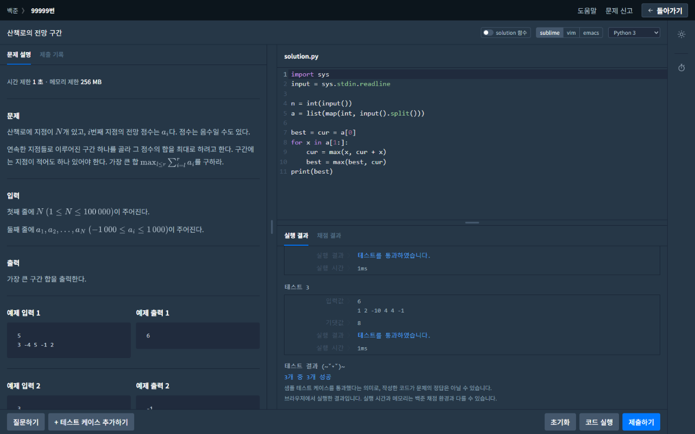
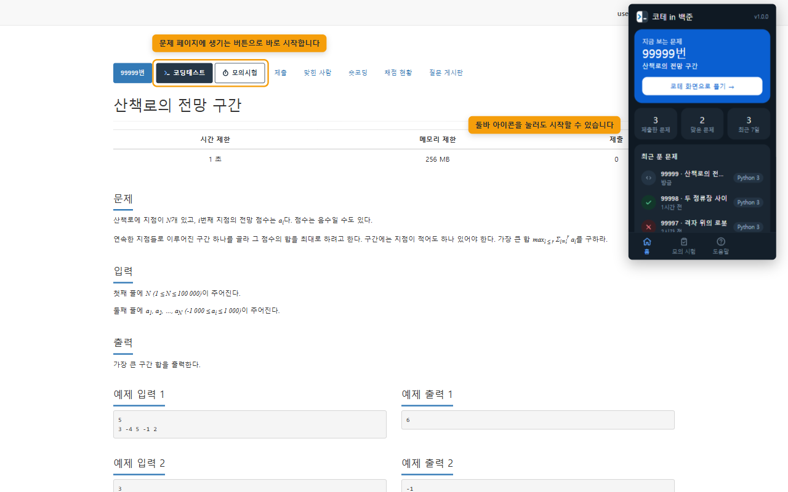
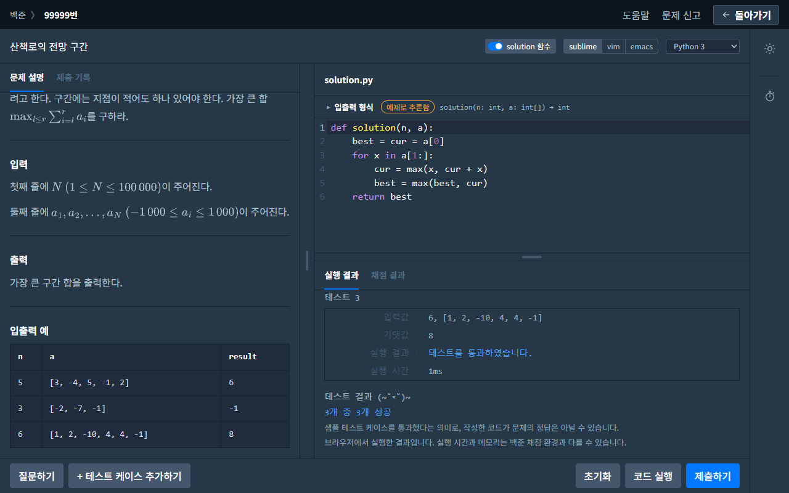
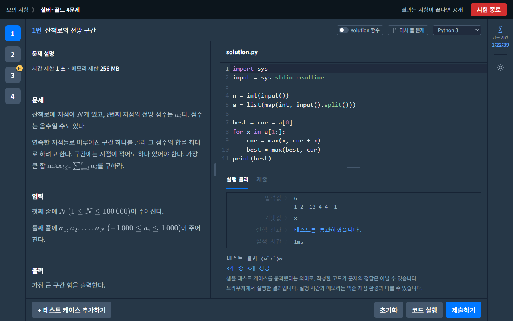
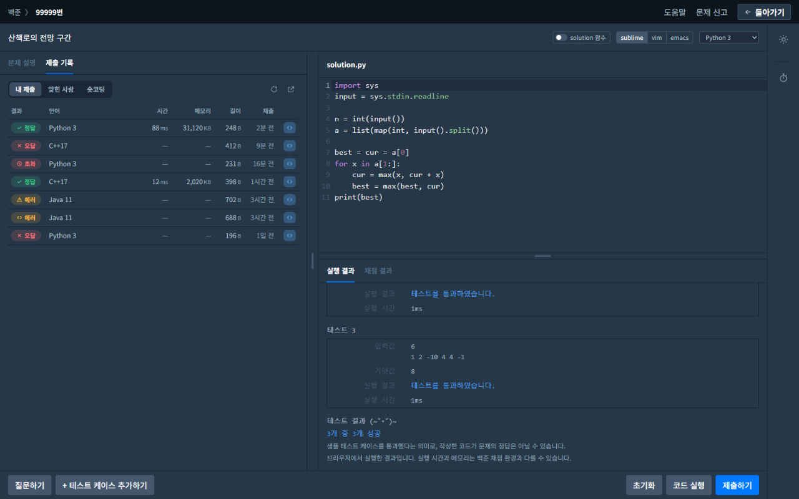

<div align="center">


# 코딩테스트 in 백준

**백준 문제를 실제 코딩테스트 시험 화면처럼 풀어 보세요.**<br>
문제 읽기 → 코드 작성 → 예제 실행 → 제출까지, 한 화면에서 끝납니다.

[](https://chromewebstore.google.com/detail/haamkmjcfncehfmnabiahbdghcemfjmn)

[](https://chromewebstore.google.com/detail/haamkmjcfncehfmnabiahbdghcemfjmn)
[](LICENSE)



<sub>백준 온라인 저지(스타트링크)와 관계없는 비공식 프로그램입니다. 최종 채점은 항상 백준에서 이루어집니다.</sub>

</div>

## 🙋 이런 분께 추천합니다

- ✅ 코딩테스트를 앞두고 **시험과 같은 화면**에서 연습하고 싶은 분
- ✅ 입출력 코드 없이 **solution 함수만 작성하는 방식**에 익숙해지고 싶은 분
- ✅ **시간을 재며** 여러 문제를 시험처럼 풀어 보고 싶은 분
- ✅ 에디터와 백준 사이를 오가며 **복사·붙여넣기** 하는 것이 번거로운 분

## 🚀 3단계로 시작하기

| | |
|:---:|---|
| **1️⃣** | [웹스토어](https://chromewebstore.google.com/detail/haamkmjcfncehfmnabiahbdghcemfjmn)에서 설치하고 백준 문제 페이지를 엽니다. |
| **2️⃣** | 문제 메뉴에 생긴 **[코딩테스트]** 버튼을 누릅니다. |
| **3️⃣** | 코드를 쓰고 **[코드 실행]** 으로 예제를 확인한 뒤 **[제출하기]** 를 누릅니다. |

> 💡 모의 시험은 문제 메뉴의 **[모의시험]** 버튼이나 툴바의 확장 프로그램 아이콘에서 시작합니다.



## ✨ 주요 기능

### 🖥️ 한 화면에서 풀기
왼쪽에는 문제와 제출 기록, 오른쪽에는 에디터와 실행 결과가 보입니다. 수식과 예제는 백준과 똑같이 보여 주고, 외국어 문제는 🌐 한국어로 번역해 줍니다(원문 보기 가능).<br>
🌙 다크·라이트 테마 · ⌨️ sublime·vim·emacs 키맵 · ⏱️ 스톱워치와 타이머

### ▶️ 브라우저에서 바로 실행
예제와 직접 추가한 테스트 케이스로 실행하고, 통과 여부와 기댓값과의 차이를 보여 줍니다. 실행 환경이 확장 안에 들어 있어 📦 따로 설치할 것이 없고, 코드는 🔒 인터넷이 차단된 격리된 공간에서 실행됩니다.

### 🧩 solution 함수로 풀기
입출력 코드 없이 solution 함수만 작성하는 코딩테스트 방식으로 풀 수 있습니다. 많이 푼 문제에는 입출력 형식이 미리 준비되어 있고, 예제는 '입출력 예' 표로 보여 줍니다.

### 📝 모의 시험
난이도와 알고리즘 분류를 골라 시간 제한이 있는 시험 세트(최대 8문제)를 만듭니다. 시험 중에는 아무것도 제출하지 않고, 시험이 끝나면 답안을 백준에 차례로 제출해 결과를 모아 보여 줍니다.

### 📤 백준으로 제출
[제출하기]를 누르면 백준 제출 페이지가 뒤쪽 탭에서 열려 언어와 코드를 채우고 제출 버튼까지 누릅니다(직전에 잠깐 취소 가능). ⏳ 채점 진행 상황과 ✔️ 결과가 풀이 화면에 바로 나타납니다.

### 📊 제출 기록
그 문제의 '내 제출', '맞힌 사람', '숏코딩' 목록을 풀이 화면 안에서 봅니다. 공개된 코드를 열어 보고, 내 지난 코드를 에디터로 불러올 수 있습니다.

## 📸 화면 둘러보기

<table>
  <tr>
    <td width="50%"></td>
    <td width="50%"></td>
  </tr>
  <tr>
    <td align="center"><b>🧩 solution 함수로 풀기</b></td>
    <td align="center"><b>📝 모의 시험</b></td>
  </tr>
  <tr>
    <td colspan="2"></td>
  </tr>
  <tr>
    <td colspan="2" align="center"><b>📊 제출 기록</b></td>
  </tr>
</table>

## 🗣️ 지원 언어

| | 언어 |
|---|---|
| **▶️ 실행 + 제출** | C · C++ 14/17/20 · Python 3 · Java 8/11 · JavaScript · TypeScript |
| **📤 작성 + 제출** | Kotlin · Rust · Go · Swift · C# · Ruby |

## 🔐 개인정보

- 💾 작성 중인 코드와 테스트 케이스는 **내 브라우저에만** 저장됩니다.
- 🚫 운영자 서버가 없고, 사용 통계나 광고를 쓰지 않습니다.
- 🌐 외국어 문제를 번역할 때만 문제 문장을 구글 번역으로 보냅니다. 코드, 아이디, 로그인 정보는 보내지 않습니다.

자세한 내용은 [개인정보처리방침](docs/privacy.md)에 있습니다.

## ⚠️ 알아 두세요

- 제출과 채점에는 백준 로그인이 필요합니다.
- 브라우저 실행 결과(시간, 메모리)는 백준 채점과 다를 수 있습니다.
- 자동 제출은 백준 이용 규칙에서 금지하는 '자동 제출 도구'에 해당할 수 있습니다. 위험은 사용하는 계정에 있습니다([PRD 8.1](docs/PRD.md)).

<details>
<summary>엣지에서 쓰거나 직접 설치하려면</summary>

- **엣지**: 크롬 웹스토어 페이지에서 '다른 스토어의 확장 허용'을 켜면 그대로 설치할 수 있습니다.
- **직접 설치**: [릴리스](https://github.com/vi-wolhwa/cote-in-baekjoon/releases)에서 `cote-in-baekjoon-x.y.z-chrome.zip`을 내려받아 압축을 풀고, `chrome://extensions`에서 '개발자 모드'를 켠 뒤 '압축해제된 확장 프로그램을 로드합니다'로 그 폴더를 고릅니다. 이렇게 설치하면 자동 업데이트가 되지 않습니다.

</details>

## 💬 문의와 제안

[이슈](https://github.com/vi-wolhwa/cote-in-baekjoon/issues/new/choose)에 남겨 주세요. 실행 결과가 백준과 다를 때는 문제 번호와 언어를 함께 알려 주시면 빨리 확인할 수 있습니다.

## 🛠️ 개발

Node 24가 필요합니다.

```bash
npm ci
npm run lint && npm run typecheck && npm test   # 린트, 타입, 단위 테스트
npm run build                                   # .output/chrome-mv3
npm run e2e                                     # Playwright (빌드 후)
```

- [기여 안내](.github/CONTRIBUTING.md)
- [제품 요구사항 (PRD)](docs/PRD.md) · [로드맵](docs/roadmap.md) · [설계 결정 (ADR)](docs/adr/)
- 함께 들어 있는 오픈소스와 라이선스: 도움말 페이지 아래 "오픈소스 라이선스" 또는 `third_party/licenses/`

## 📄 라이선스

[MIT](LICENSE). 확장에 함께 들어 있는 오픈소스(Pyodide, LLVM, TeaVM, OpenJDK javac 등)는 각자의 라이선스를 따릅니다.
